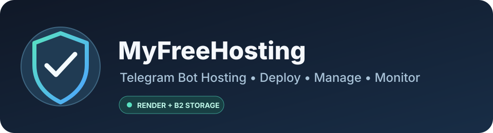

<!-- MyFreeHosting | polished repository overview -->

  

  
  
  
  

<h1 align="center">MyFreeHosting</h1>

<strong>A web-based control panel to upload, deploy, manage, and monitor Telegram bot scripts.</strong>

  <a href="https://myfreehosting1.onrender.com/"><strong>🚀 Open Website</strong></a>
  &nbsp;•&nbsp;
  <a href="https://github.com/Anandsinghsarkar/Myfreehosting1"><strong>📂 Browse Source</strong></a>

---

## ✨ Project Overview

MyFreeHosting is a browser-based Telegram bot hosting panel. It provides a central place to submit bot scripts, manage deployments, review bot status, and inspect logs. The project is designed around a Render-hosted application with Backblaze B2 object storage for bot-file backups, while Firebase Authentication and Firestore are used for authentication and application records.

> **Deployment note:** This README describes the repository's current implementation. Service availability and provider quotas depend on the hosting and storage accounts configured by the operator.

## 🧩 Features at a Glance

<table>
  <tr>
    <td width="50%">
      <h3>📤 Script Deployment</h3>
      Upload Python or JavaScript bot files, or create a Python bot by pasting code into the panel.
    </td>
    <td width="50%">
      <h3>🛠️ Bot Management</h3>
      View hosted bots, edit supported Python scripts, start or stop processes, and remove bots.
    </td>
  </tr>
  <tr>
    <td width="50%">
      <h3>📟 Live Logs & Status</h3>
      Inspect bot output, startup/install messages, process status, and reported errors in the panel.
    </td>
    <td width="50%">
      <h3>☁️ Persistent Object Backup</h3>
      Back up bot files and runtime/session data to a private Backblaze B2 bucket and restore them when needed.
    </td>
  </tr>
  <tr>
    <td width="50%">
      <h3>🛡️ Admin Review</h3>
      Bot submissions can remain pending until an administrator reviews and approves them.
    </td>
    <td width="50%">
      <h3>📊 Storage Monitor</h3>
      Admin storage view reports app-managed Render files and Backblaze object usage estimates/measurements.
    </td>
  </tr>
</table>

## 🔗 Website & Repository

| Resource | Link |
|---|---|
| 🌐 Live Website | [https://myfreehosting1.onrender.com/](https://myfreehosting1.onrender.com/) |
| 💻 GitHub Repository | [Anandsinghsarkar/Myfreehosting1](https://github.com/Anandsinghsarkar/Myfreehosting1) |
| ❤️ Issues & Feedback | [Open a GitHub issue](https://github.com/Anandsinghsarkar/Myfreehosting1/issues) |

## 🧭 How It Works

<table>
  <tr><th align="center">01</th><th align="center">02</th><th align="center">03</th><th align="center">04</th></tr>
  <tr>
    <td align="center"><strong>Submit</strong> Upload a supported script or paste Python code.</td>
    <td align="center"><strong>Review</strong> Admin approval applies when enabled for the account.</td>
    <td align="center"><strong>Deploy</strong> The application prepares dependencies and launches approved bots.</td>
    <td align="center"><strong>Back up</strong> Bot files and supported runtime data sync to private B2 storage.</td>
  </tr>
</table>

## 🧰 Technology

<table>
  <tr><th>Component</th><th>Role</th></tr>
  <tr><td><strong>Python / Flask</strong></td><td>Web application and server-side routes.</td></tr>
  <tr><td><strong>Render</strong></td><td>Application and bot-process runtime.</td></tr>
  <tr><td><strong>Backblaze B2 (S3 API)</strong></td><td>Private object storage for bot files and backups.</td></tr>
  <tr><td><strong>Firebase Authentication</strong></td><td>User authentication.</td></tr>
  <tr><td><strong>Firestore</strong></td><td>Application records such as users, scripts, and settings.</td></tr>
  <tr><td><strong>boto3</strong></td><td>S3-compatible communication with Backblaze B2.</td></tr>
</table>

## 🚀 Deployment & Configuration

The application is configured for Render. Set environment variables in the Render service dashboard rather than committing credentials to the repository.

### Backblaze B2

Create a **private** B2 bucket and a dedicated application key with the permissions required for listing, reading, writing, and deleting the bot objects managed by the app. Configure:

| Variable | Description |
|---|---|
| `B2_BUCKET_NAME` | Exact B2 bucket name |
| `B2_ENDPOINT` | S3 endpoint for the bucket's region, e.g. `https://s3.us-east-005.backblazeb2.com` |
| `B2_REGION` | Bucket region, e.g. `us-east-005` |
| `B2_KEY_ID` | Application Key ID |
| `B2_APPLICATION_KEY` | Application Key secret |
| `B2_QUOTA_GB` | Optional display quota in GiB; defaults to `10` |
| `B2_UPLOAD_WORKERS` | Optional parallel upload count; defaults to `4` (maximum `8`) |

Keep the bucket private and keep credentials server-side. Never add B2 keys to frontend code, public commits, screenshots, or bot source. CORS is not needed for server-to-server requests from the Render backend.

### Render display settings

| Variable | Description |
|---|---|
| `RENDER_APP_STORAGE_QUOTA_MB` | Configured app-file quota shown in the admin panel; defaults to `512` |
| `KEEP_ALIVE_ENABLED` | Enables/disables the internal health-ping loop |
| `KEEP_ALIVE_URL` | Optional explicit public Render service URL |
| `KEEP_ALIVE_INTERVAL_MINUTES` | Keep-alive interval, clamped by the app to a safe range |
| `SESSION_DAYS` | Session lifetime in days; defaults to `30` |
| `SECRET_KEY` | Flask session signing secret; set a strong unique value |

Other Firebase and admin environment variables are read by the application configuration. Configure those in Render according to your Firebase project and authentication setup.

## 🗂️ Upload & Runtime Notes

- Direct file upload supports **`.py` and `.js`** scripts, up to the application's configured request limit.
- The Create Bot flow supports pasted Python source, optional `requirements.txt` content, and bot-specific environment variables.
- Python dependencies are installed for the bot; Node dependencies are prepared for JavaScript projects.
- Approved deployments and Backblaze backups are performed in background tasks so the upload request can return promptly.
- ZIP uploads and automatic archive extraction are currently **disabled**.
- Render's local filesystem is ephemeral. Persistent bot files should be backed up to B2 and restored after service restarts/redeployments.
- Storage figures in the admin panel are measurements/estimates within the application's configured scope, not a complete provider billing report.

## ⚠️ Security & Isolation

<table>
  <tr>
    <td>🔐 <strong>Protect secrets</strong> Keep Firebase admin credentials, B2 keys, and Flask secrets in server environment variables.</td>
    <td>🧑‍💻 <strong>Review submitted code</strong> Only run bot code that you trust and understand.</td>
  </tr>
  <tr>
    <td>🧱 <strong>Isolation limitation</strong> Bot processes run in the same Render service/container as the website; this project is not a hardened per-customer sandbox.</td>
    <td>📦 <strong>Resource limits</strong> Large dependencies or resource-heavy bots may exceed the available memory, disk, or runtime limits.</td>
  </tr>
</table>

## 🩺 Health Check & Keep-Alive

- `GET /health` returns a lightweight JSON health response.
- An optional GitHub Actions workflow can ping the service. Configure the repository variable `TARGET_URL` with the base Render URL, then enable and run the workflow.
- Scheduled GitHub Actions runs are best-effort and may be delayed. They do **not** guarantee always-on availability or prevent platform restarts/suspension.

## 🤝 Support & Contributions

Found an issue or have an improvement idea? Please open a [GitHub issue](https://github.com/Anandsinghsarkar/Myfreehosting1/issues) with a clear description and relevant, redacted logs. **Do not include passwords, API keys, tokens, or private user data.**

## 📄 License

Check the repository's [LICENSE](LICENSE) file for the applicable license. If no license file is present, usage and redistribution permissions have not been explicitly granted.

---

  <strong>MyFreeHosting</strong> 
  Deploy • Manage • Monitor • Back up

